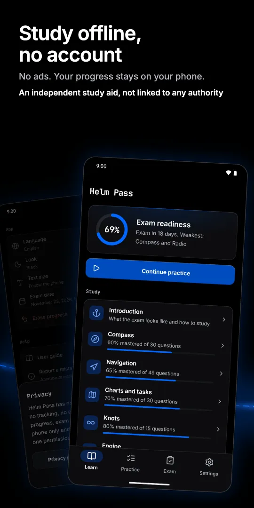

  

<h1 align="center">Helm Pass</h1>

Practise the Croatian boat licence B (voditelj brodice B) exam the way it is really held: oral questions, chart tasks and knots. Free study material, Pro paid once, fully offline.

  <a href="https://play.google.com/store/apps/details?id=com.zanoshky.helmpass"><b>Google Play</b></a> ·
  <a href="https://helmpass.zanoski.com"><b>helmpass.zanoski.com</b></a> ·
  <a href="https://github.com/Zanoshky/helm-pass-app/issues/new/choose"><b>Report a bug</b></a>

  

This repo is the public home for Helm Pass users: bug reports and feature requests. The app is an Android study app, free with an optional Pro paid once, and its source is not here.

Helm Pass is an independent study aid. It does not represent any government entity and does not issue licences.

## Quick start

1. Install Helm Pass from Google Play. It runs on Android 10 or newer.
2. Open Study and read a topic, or open Practice and answer a question out loud.
3. Reveal what a good answer covers and mark whether you knew it.
4. With Pro, set your exam date, try the mock exam and the chart tasks.

## Report a bug or ask for a feature

1. Search the [open issues](https://github.com/Zanoshky/helm-pass-app/issues) first. If yours is there, add a thumbs up or a comment.
2. Otherwise open a [bug report](https://github.com/Zanoshky/helm-pass-app/issues/new?template=bug_report.yml) or a [feature request](https://github.com/Zanoshky/helm-pass-app/issues/new?template=feature_request.yml).
3. Add your app version, phone model and Android version, and a screenshot if you can. Helm Pass keeps your progress on your phone and has no account, so there is nothing private in a screenshot, but crop out anything else on your screen.

No GitHub account? Write to support@zanoski.com.

## License

The text and images in this repo are shared under [CC BY 4.0](LICENSE). The Helm Pass app itself is proprietary and is not covered by this license.
